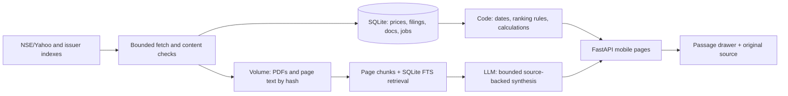

# Decisions and delivery plan

Updated 2026-10-30 (Asia/Kolkata). Deadline: Sunday, November 1, 2026 (M p. 1); exact hour/timezone unknown. Today plus October 31 and part of November 1 are available; a full 72-hour window is not assumed. A small local HTML/JS interaction preview is now implemented and browser-checked. Integrated ingestion, model calls, hosting and final-product acceptance are still pending.

## Decision log

| ID | Status | Decision and reason | Evidence / trade-off | Revisit when |
| --- | --- | --- | --- | --- |
| D-001 | Completed-stage boundary; lifted for preview | The initial no-code instruction applied to research/planning. The user explicitly authorised a small local interactive preview on October 30. | Latest implementation request; no paid hosting/API use authorised by this preview request | Full integration remains a separate next stage |
| D-002 | Agreed working direction | Understand problem, research products and user feedback, verify sources, decide scope, then build and test. | User's proposed sequence; primary data/generalisation constraints in M pp. 2-3 | Research or source checks expose a blocker |
| D-003 | Proposed | Build two narrow workflows: proactive portfolio triage and on-demand company investigation with inspectable primary evidence. | M pp. 1-4; meets both modes while limiting breadth | After bounded research |
| D-004 | Proposed | Start with 15 portfolio companies and 3 ad-hoc research demos, including an outside-portfolio case. | M pp. 1-2; lower end of required portfolio size preserves time | Representative source coverage verified |
| D-005 | Proposed | Prefer responsive web for easy phone access and fewer distribution steps. Framework/hosting/model remain undecided. | M p. 4 allows responsive web; speed is our rationale | Existing skills, deployment feasibility, and source runtime requirements are checked |
| D-006 | Working practice | Preserve real AI conversation history from now; maintain these four notes as the concise project record. | AI build history is a submission deliverable (M p. 4) | Confirm export/share mechanism before final packaging |
| D-007 | Proposed | Aim for a working deployed version by October 31 evening; reserve November 1 for fixes/access checks/submission. | Deadline cutoff unspecified; M p. 4 prioritises a running demo | Actual hours available become clear |
| D-008 | Research complete; implication proposed | Stop competitor expansion after five products. Differentiate through a concise portfolio-change-to-evidence journey, not the mere presence of AI summaries, citations, or filters. | research.md R-001 through R-005 and R-011: existing products already offer these components | Real source feasibility and a later usability check |
| D-009 | Proposed engineering principle | Separate document extraction, deterministic numeric calculations, and prose explanation; preserve provenance and show unavailable/ambiguous evidence. | R-006 and historical failure-mode feedback R-008/R-009; vendor workflow descriptions are attributed, not copied as known private architectures | Source verification determines the simplest adequate implementation |
| D-010 | Feedback pass complete; proposals remain open | Close feedback collection after a bounded 48-entry working sample. Prioritise reading/list reliability, concise synthesis, and honest coverage; do not claim universal AI distrust or a proven missing-citation gap. | research.md R-013 to R-017 and sample/access ledger; no product defect reproduced | Data experiments and later phone/task checks |
| D-011 | Proposed | Keep brokerage sync, payment flows and multiple alert channels outside this prototype despite requests in commercial-product reviews. Test digest-to-source navigation and return position with the full portfolio size. | Relevant/peripheral feedback distinction; mock portfolio and thin working prototype in assignment | Core retrieval works and remaining time permits read-state refinement |
| D-012 | Local feasibility established; provider choice proposed | Use completed-session EOD data, with official NSE daily file a practical candidate and explicit source/date/missing-value handling. Prefer ticker-based NSE announcement/annual metadata plus issuer indexes. Do not infer cloud reliability or reuse rights from successful local requests. | R-018/R-019; V-011 to V-015 and V-040 to V-042 | Small actual-runtime retrieval check and full portfolio selection |
| D-013 | Recommended scope reduction, not yet implemented | Core pull: concise business/management investigation from available annual report + actual call text, a few checked figures and visible coverage. Keep full four-quarter promise-versus-delivery optional. Cera is a viable manually checked analytical example; recent KPR calls and Apollo full-call ingestion unresolved. | R-020/R-021; explicit extraction and chronology failures in verification.md | If additional verified evidence and time make deeper comparison inexpensive |
| D-014 | Recommended plan | Choose attention-first digest plus evidence-backed investigation. One FastAPI/Jinja/HTMX service, SQLite FTS5 + persistent volume, PyMuPDF and bounded jobs; propose Railway Singapore and GPT-6 Luna. Full plan below supersedes earlier undecided-stack proposals. | Requirements M pp. 1-4; R-013 to R-023; observed source/extraction constraints | Actual-runtime gate, ten factuality cases, credentials/budget input |
| D-015 | Bounded competitor recheck complete; design remains proposed | Keep the same five-product sample. Prioritise understandable event importance and passage-level evidence with a reliable return journey. Do not spend the remaining deadline window recreating brokerage integration, trading tools or enterprise research infrastructure. | Official-page and six-visual recheck; research.md comparison summary; V-048 to V-050. Sources/filtering already exist commercially; our usability opportunity is unproven. | Source/runtime checks or actual mobile task testing reveal a concrete need; no further generic market survey |
| D-016 | Implemented for local preview only | Use buildless HTML/CSS/JS with a Python standard-library loopback server to inspect Digest, all 15 Companies, Investigate and Evidence before integration. Prepare dated local samples offline; summaries/priorities are manually authored and labelled. | User explicitly permits a simpler local HTML preview. No framework install or credential dependency. This is not an alternative production-architecture comparison or proof of live AI/generalisation. | Actual preview feedback; then return to the existing integrated-product plan |

Proposals are not settled requirements. Explain significant decisions using: problem, evidence, alternatives, chosen trade-off, and how we will verify it. Record the reason before implementation makes a choice expensive to change.

## Local interactive preview delivered October 30

Run/open: `python .\preview\serve.py --port 8765` from the workspace root, then **http://127.0.0.1:8765**. The server was left running for user inspection. It binds to this computer only; a physical phone cannot use its own localhost to reach it. The confirmed browser test viewport was **390×844 CSS pixels**.

Files: `preview/dist/index.html`, `style.css`, `app.js`, `source.html`, `source.js`, generated `data.json`; `prepare_samples.py`, explicit `document_routes.json`, `serve.py`, `check_preview.py`, README and evidence screenshots/results. No third-party app dependencies, paid account, model request or upstream refresh was introduced.

Implemented: eight selected real filing examples, two manually prioritised; the fifteen previously selected companies; four dated official EOD samples; business/management saved views for INFY/CERA, limited KPR/APOLLO cases and eleven not-loaded cases. The drawer offers original passages, company/document/period/page, saved source-page reader, saved full PDFs and original-source links. Native Back/Escape/close, tab focus wrap, filter/search/sort state and reading-position return were checked. Original links open a separate tab to preserve context. KPR original NSE PDF actually opened in the browser.

Preview state examples: replay loading (explicit simulation); empty 30 October saved window; routine-only and metadata-only filings; KPR August 2023 call explicitly stale; Apollo cover letter/full-call-403 explicitly partial. None produces invented live content.

Verification: **42/42** local HTTP/content/source-identity checks; browser action record in `preview/browser-results.json`; screenshots in `preview/screenshots/`; precise scope/limits in verification.md V-051 onward. A keyboard wrap issue found during inspection was fixed and retested. No real-phone task study, full platform acceptance or arbitrary-ticker research is claimed. Do not mark the recruitment checklist complete from this preview.

## Recommended product and technical plan

### Current budget and implementation override · October 30

**Free tiers only.** The paid Railway plan, earlier $10 hosting / $5 API allowance and paid-model recommendation below are superseded, not approved. The user reports an OpenAI key is available for secure setup later; credits are unconfirmed. No model call is enabled or needed for this push slice. No secrets are requested in chat.

Current implementation extends the preview's HTML/CSS/JS with Python standard-library HTTP routes, SQLite and the existing PyMuPDF extraction approach. This avoids a frontend rewrite or unnecessary framework installation. `app/adapters.py` refactors the working NSE request/CSV/announcement logic without the experiments' cache; every refresh issues actual requests. Files/requests carry original URL, UTC retrieval time, status, bytes/hash and validation outcome. Financial tables are not automatically summarised; EOD arithmetic is deterministic.

**Free deployment route: Render Free Python Web Service**, with `render.yaml` and `.python-version` prepared. Local SQLite persists on this computer. On the free host, SQLite/PDF files are temporary: cold startup can restore an explicitly dated, automatically exported full-refresh snapshot, then request-triggered catch-up rebuilds sources. No scheduled refresh while sleeping is promised, no keep-alive service is added, and no persistent volume/paid cron is provisioned. Snapshot restores preserve original retrieval times and omit raw PDF bytes; missing cached PDFs can be fetched again or opened at the original source.

Exact setup pending: sign in to a Render account; provide a Git repository the service can read (or create/connect one in the coordinating chat); create the service with **Free** compute and verify included usage/spend settings without adding a payment method or paid add-ons. The dashboard opened at `/login`; no Render API credentials or authenticated dashboard access were available. Therefore cloud creation and the **actual hosted NSE retrieval check remain pending**. Neither local success nor the prepared YAML proves cloud network access. Continue local work independently.

Refresh architecture: one bounded job/SQLite lease, per-company outcomes, metadata upserts, immutable response hashes; manual selected-company/all-15 refresh and stale-on-request catch-up. Global request limits are prototype safeguards and reset with an ephemeral runtime. No assumption of durable cloud job history, always-on scheduling or complete exchange-feed reconciliation.

Planning revision: October 30, 2026. Requirements are in requirements.md; supporting observations are research.md R-001 through R-021 and verification.md V-011 through V-043. Recommendations below are concrete proposals, not implemented features or additional assignment requirements. No application scaffold, deployment, subscription or model call was created in this planning stage.

### Two focused directions

| Direction | Investor value | Reliability and deadline trade-off |
| --- | --- | --- |
| A. Portfolio attention digest -> evidence -> company investigation | Quickly find consequential developments, then investigate without restarting elsewhere. Meaningful push and pull share company/document context. | Reuses verified EOD/NSE routes. Useful even with partial document coverage. Main risk is event prioritisation quality; expose its reason and keep routine items accessible. |
| B. Company research notebook with an updates inbox | Stronger deep-reading experience and reusable company questions; push becomes a supporting inbox. | More dependent on current transcripts and robust retrieval before it feels useful. Tempts us toward a broad chat/report generator, while Apollo blocked calls and KPR old calls weaken coverage. |

**Recommend A.** It matches the attention problem (M pp. 1-2), the thin-working-product preference (M pp. 3-4), and feedback about readable monitoring and mobile controls (R-013 to R-017). Competitors already have summaries, filters and source links; our hypothesis is that this connected path can be executed particularly clearly, not that it is a proven market gap. Evidence links are also an assignment/factuality discipline, not established universal user demand.

### Mobile experience and core scope

**First screen: Today / selected period.** Default last 24 hours, optional 7 days and custom dates in IST. Show last successful filing refresh, EOD trading date, and coverage such as 14/15 companies checked; do not hide a failed fetch inside an empty digest. If no filings occurred, say so and offer another period. If a dated demonstration window is used, label the exact dates; do not present it as today's feed.

Then show a compact attention section ordered by materiality tier and timestamp. Each event contains company/ticker, event type and exchange time, one-sentence change, one concrete reason to review it, and Evidence / Investigate actions. Routine records remain under an expandable section with a count; unknown categories remain visible, not silently buried. Initial priority uses transparent rules: results, substantive management changes, acquisitions/fundraising or regulatory concerns generally merit review; meeting notices and routine compliance generally rank lower. Type alone never proves financial materiality. LLM labels are suggestions with uncertainty; rules provide conservative defaults.

**EOD section:** all 15 companies have a dated row/card with close (INR/share), day move, traded volume (shares), provider and missing-data status. Sort alphabetically/by move. Compute move from official close and previous close; do not use turnover or delivery quantity as volume. No fabricated value when missing. An optional unusual-volume ratio requires 20 valid preceding sessions excluding the current session; omit with explanation if that history is incomplete. It is not a core launch dependency. Price movement and a nearby filing are not automatically cause and effect.

**Next action: Investigate this company**, from an event, an EOD row or ticker search. Default question: "What does this business do, what is management saying now, and what evidence or risks should I check?" Produce a concise brief: business/segments from the annual report; latest available call commentary with its date; 2-3 grounded observations or open questions, and a few verified financial facts only where available. A company without a current call gets a clearly partial brief, not invented management commentary. Offer two focused follow-ups (e.g. cash conversion, management outlook/risks) plus a bounded text question. No eight-section generated report by default.

**Evidence interaction:** numbered references open a bottom sheet containing a short original passage, source title/type, company, fiscal period, PDF page, accounting basis where relevant, and original-document link. The whole source inventory is one tap away. Return restores company, filters and scroll position. On phones, extracted passages are the primary reading aid; the original PDF remains accessible. Opening a PDF at a page may vary by browser, so never rely on that fragment alone. Keep first brief at <=250 words excluding evidence. Report contradictions instead of smoothing them away.

Bottom navigation: Digest, Companies, Investigate. A company page can show its EOD row, recent filings and document coverage, not a second analytics dashboard. Read/unread state and preferences are local to the reviewer's browser; no account system. Preserve state across page navigation; allow reset of mock data/preferences. Important controls should remain available without horizontal page scrolling.

### Proposed portfolio and research demos

These are research-design choices, not investment recommendations. Size labels are rough diversity intentions, not verified October 30 market-cap ranks. All 15 need a coverage pass in the actual runtime; no claim of current transcripts for the untested 11.

| NSE ticker | Company / sector | Selection reason / intended scale | Evidence already tested |
| --- | --- | --- | --- |
| INFY | Infosys / IT services | Large global services business, clear reporting | EOD, metadata, current annual report and actual Q2 FY27 call bundle locally verified |
| RELIANCE | Reliance Industries / diversified energy-retail-digital | Large multi-segment business | Not tested |
| HDFCBANK | HDFC Bank / banking | Large financial-sector contrast; no generic EBITDA assumption | Not tested |
| BHARTIARTL | Bharti Airtel / telecom | Capital-intensive recurring-services business | Not tested |
| LT | Larsen & Toubro / engineering and construction | Orders/project execution context | Not tested |
| MARUTI | Maruti Suzuki / automobiles | Manufacturing, volumes and demand | Not tested |
| SUNPHARMA | Sun Pharmaceutical / pharmaceuticals | Regulatory and product-development context | Not tested |
| HINDUNILVR | Hindustan Unilever / consumer staples | Consumer demand, mix and margin context | Not tested |
| NTPC | NTPC / power generation | Utility/capacity and capex context | Not tested |
| TATASTEEL | Tata Steel / metals | Cyclical commodity/multi-geography context | Not tested |
| APOLLOHOSP | Apollo Hospitals / healthcare | Healthcare and useful partial-coverage case | EOD/metadata, original annual report work; revised PDF rejected, full call local 403 |
| KPRMILL | KPR Mill / textiles | Different business scale; integrated textile/sugar exposure | EOD/metadata/current AR/results work; downloaded call is old, Q1 FY24 |
| CERA | Cera Sanitaryware / building products | Smaller business and document-backed analytical example | EOD via NSE fallback; AR, four recent call transcripts and tables checked |
| PERSISTENT | Persistent Systems / IT services | Mid-sized IT contrast to Infosys | Not tested |
| ELGIEQUIP | Elgi Equipments / industrial equipment | Smaller export-oriented manufacturing contrast | Not tested |

Three proposed research demos: **INFY** (current complete source-backed journey), **CERA** (business/current commentary; optional checked revenue-guidance example), **TITAN** (outside portfolio, discovery/generalisation demo). TITAN is not yet tested and must earn its demo slot through real source checks; a coverage failure must be disclosed, not concealed by prepared text. Apollo/KPR are additional failure-state checks, not advertised as fully covered research demos. No portfolio weights, purchase prices or broker imports are needed; this mock portfolio is a set of holdings to monitor.

### Document state must affect both UI and retrieval

Track access, extraction, period and version separately; multiple states can coexist.

| State | Investor-facing behavior / research rule |
| --- | --- |
| Missing | "No transcript found in the checked sources as of [time]"; list routes checked. Not "the company has no calls." |
| Older/stale | Show call quarter/date prominently; warn when older than a newer known reporting period or a configurable age threshold (initially 120 days). Older text may explain history, never current management guidance. |
| Blocked | Preserve HTTP 403 and attempt time; no repeated automated evasion. Offer original link and a partial brief from accessible sources. Web-tool lookup is not ingestion. |
| Cover letter / notice | Show as announcement and follow its published document reference normally. Require actual call body/participants before classifying it as an ingested transcript. |
| Malformed / image-only | Quarantine from model context; report extraction failure or OCR needed. No blank output disguised as successful research. |
| Superseded | Preserve version/hash/provenance but exclude old version from default current retrieval when a usable replacement exists. |
| Revised version unusable | Keep warning that newer changes are unverified; original report can be a labeled fallback for historical description, not represented as recovered revised/current facts. |

Examples to retain as regression evidence: CERA Yahoo null, KPR bad IR path and stale call, INFY separate press conference versus actual call, Apollo cover letter/403 and malformed revision. Do not silently fix Cera's apparent comparative-year typo or combine revenue presentations across periods. Failed table detection means no universal automatic table standardisation promise.

### Architecture and stack recommendation

**One Python 3.12 service: FastAPI + Jinja2 templates + small self-hosted HTMX/vanilla JavaScript + CSS; SQLite with FTS5; PyMuPDF; one persistent filesystem volume; one model provider.** Use standard `sqlite3` and Pydantic schemas, not an ORM/migration service unless schema complexity warrants it. One Docker image and one Uvicorn process; SQLite WAL, short transactions and a bounded job queue in SQLite. No React build step, separate API deployment, Redis, vector database or agent framework. This is a scoped architecture recommendation, not a claim those tools are inherently unnecessary at scale.

**Fetching:** refactor successful functions in `experiments/data_probe.py` into adapters; retain request manifests and selection lineage. Replace filesystem wildcard selection/first-match heuristics with database IDs, explicit fiscal periods, type/content checks and revision handling. Do not ship experiment cache semantics unchanged: successful stored URL reuse currently prevents freshness checks. Add timeouts/byte limits, conditional refresh where source supports it, modest per-host pacing and at most one bounded retry for transient errors. Never retry 403 as if it were transient. Guard downloaded URLs against private IPs/internal hosts and recheck redirects; only ticker/index-based discovery, not arbitrary user URL fetching. Document text is untrusted data, not instructions to tools or the model.

**Storage:** minimal entities: companies/identifiers; holdings; EOD bars; filings with exchange ID and timestamps; documents with type/period/basis/version/access/extraction status; per-page chunks; evidence-backed facts; jobs; cached answers and model-usage records. Keep requested/final URL, retrieved_at UTC, source_date/reporting_period, content SHA256 and PDF page separately. Deduplicate by exchange ID plus attachment hash, retaining provenance for repeated exchange copies. PDFs/page text live under volume `/data`; SQLite there too. Keep secrets only in server environment. Browser localStorage holds read state/filter preferences, not API credentials.

**Updates:** initially fetch filings hourly for 15 holdings, incremental overlapping window and deduplication; EOD at 18:30 IST on trading days with one later publication check if missing. No promise of instant alerts. Refresh annual/call metadata once daily and on explicit investigation when cache is stale; only download new hashes/versions. One scheduler inside the always-running process, with persisted due times and job leases so restart catches up once and duplicate jobs do not overlap. One extraction worker; do not parse 15 large reports concurrently. In-process scheduling tolerates short downtime and is explicitly not highly available. Show last successful check per company/source, plus failures.

**Extraction/retrieval:** PyMuPDF text page by page, retaining page/section/bounding-box provenance and diagnostics. Reject structurally broken PDFs; isolate extraction in a bounded subprocess so errors cannot take down requests. Start with one report + latest eligible actual call per company, 500-900-word chunks with small within-section overlap and original page spans. FTS5 lexical retrieval plus simple query aliases and filters for ticker/type/period. Retrieve both AR and call context for the default brief; never silently search a different company. Broad snapshots use section-aware sampling; fail with an evidence limit if pertinent passages cannot be retrieved. Retrieval quality must be tested; FTS alone is not assumed sufficient for every semantic question. Add lightweight embeddings only after a demonstrated retrieval failure and remaining time justify them.

**Figures:** EOD differences and any YoY/QoQ/margin arithmetic use Decimal/code. Never infer a number from prose or select column/basis solely by model confidence. Financial facts require metric, value, currency/unit, period, basis, source/page and verification status; bank metrics differ from manufacturing. Core UI may show extracted candidate figures only after checks/manual verification; otherwise show source passage and unavailable figure. Do not hardcode CERA/KPR numbers into generic company logic. The failed table parser makes generic Revenue/EBITDA/PBT/PAT comparisons a stretch, not a core dependency.

**Model calls:** use a small structured response for event summary/proposed category, and a single bounded synthesis for an investigation with selected excerpts and verified facts. Model returns claim text plus allowed chunk IDs; server checks reference IDs exist and cited spans contain the claimed passage. That checks linkage, not entailment, so sample factuality audit remains required. No unrestricted browsing/tools, model arithmetic, invented pages, outside company knowledge, or one model call per routine filing merely to produce verbose text. Low-value filings can retain their original exchange title.

**Caching:** content extraction by hash + extractor version; summaries by hash + model/prompt/schema version; investigations by ticker/question/eligible-source hashes/period/fact version. New evidence invalidates affected answers. Previously generated answers retain generated_at/source-set dates; an outage returns explicitly dated cached content or an error. Show a partial answer only where supported, not a fake successful completion. Limit duplicate simultaneous jobs, question length, token budgets and daily spend. On cache hit, no model call. On model outage, filing feed/prices/documents remain useful.

### Discovery for an unfamiliar NSE ticker

1. Normalise/validate symbol against the official NSE symbol list when ingested; company name is resolved from authoritative metadata. Keep BSE code/ISIN mappings separately; do not guess from arbitrary search results.
2. Run the generic NSE annual-report index by symbol; select eligible latest fiscal year and submission/version, fetch and validate content. This route already worked on the additional APOLLOHOSP ticker.
3. Search ticker-specific NSE announcement windows for call/transcript entries, in bounded 90-day windows (up to four initially). Distinguish actual call body from call invitation, recording, press conference, and cover letter. Follow published PDF references with the same access policy.
4. Try configured company IR **index routes** if the exchange route has incomplete documents. Existing INFY/KPR/CERA index routes are examples, not a fixed PDF dataset. Adding an issuer adapter must improve index parsing/discovery, not insert a company-specific answer.
5. If generic sources fail for an unconfigured issuer, show the checked routes and partial/unavailable coverage. There is currently no verified automatic issuer-site discovery/search API integration. Do not claim arbitrary ticker full-call coverage is solved.

**Test:** after adapters are frozen, select two valid NSE symbols outside the 15 holdings and 3 named demos, with no IR config/PDF URLs prepared. One must discover/download AR + actual transcript through generic routes; both must preserve correct company/period and honest failure behavior. If no available-source case passes, generalisation is a launch blocker: improve generic retrieval or disclose the unresolved requirement, rather than replacing it with canned demos. TITAN is a useful outside-portfolio demo but is not an independently unprepared final test. Also run an invalid symbol and Apollo's known partial case.

### Model and hosting choice

Current official sources, prices, limits and cost assumptions are recorded in research.md R-022/R-023. Recommend **GPT-6 Luna** via server-side Responses API, low reasoning to start. Keep **GPT-6.1 Sol** as an explicit optional escalation for failed analytical evaluations, not automatic double-calling. **Gemini 3.5 Flash-Lite** is the alternative if Google access/free quota is preferable; do not build two provider integrations now. No evidence yet that any candidate meets our financial factuality bar: test 10 source-grounded cases first.

Recommend **Railway Hobby, Singapore, one persistent volume, no sleep**, subject to account access and user acceptance of the paid budget. It supports the single-service/SQLite design and is a $5 monthly minimum including $5 usage; usage above that costs extra. Target hosting allowance $10 and API allowance $5 for this submission, excluding taxes; these are proposed budgets, not charges or guaranteed ceilings. Track cost and configure provider controls when available. Render paid service + disk is an alternative; Render Free's sleeping/ephemeral filesystem is unsuitable for this chosen scheduled persistent design. Its exact current compute total was not extracted, so no invented price comparison.

### Ordered implementation plan after this planning stage

Estimate 12-16 focused hours plus submission buffer. The user's actual availability is not known; do not treat the earlier 16-20-hour assumption as guaranteed. Deadline Nov 1 has no stated cutoff/timezone; aim for usable deployment Oct 31 evening, no late feature expansion. If available time is shorter, remove optional depth before core workflows or checks.

| Order | Budget | Deliverable / stop condition |
| --- | --- | --- |
| 0 | User setup | Confirm paid hosting/API budget and provision one provider key + hosting access securely. No secrets in chat or repo. Select reviewer-access route. |
| 1 | 45-60 min | Small retrieval/extraction job in the **actual Railway Singapore service/runtime**, before full UI. Fetch completed EOD file, NSE INFY/CERA metadata, one original results attachment, AR + actual call; repeat one non-demo ticker. Persist/restart and read back hashes; record time/memory/status. Reject hosted source failures as unresolved, not local success. |
| 2 | 1.5-2 h | Refactor adapters, SQLite schema/statuses, metadata-driven discovery, source manifest and bounded jobs; run coverage pass for all 15. Do not spend hours chasing every blocked transcript. |
| 3 | 2-3 h | One complete push slice: refresh -> rank -> mobile digest/EOD -> evidence -> return position. Then populate portfolio and honest coverage states. |
| 4 | 2-3 h | Pull discovery/extraction/retrieval, one model integration and source drawer. Run ten factuality cases before adding follow-ups. |
| 5 | 1-1.5 h | Fresh-ticker generalisation tests, caches/scheduler restart, failure fixtures, public abuse/cost controls; resolve core failures. |
| 6 | 1.5-2 h | Real phone/mobile browser QA, measured tasks/latency, final coverage and number audits; deploy known-good version. |
| 7 | 1-1.5 h | Repo startup check, reviewer link access, AI history export/share, short covering email and known limits. Reserve Nov 1 for this and essential fixes. |

Optional CERA guidance example only after all core acceptance checks pass and at least one hour remains **beyond** final packaging buffer. It uses reviewed historical sources and labels 7.0418% standalone reported growth versus conditional 7-8% FY26 expectation; no universal guidance engine, margin verdict or FY27 delivery claim.

Actual-runtime gate: repeat after restart and again after >=15 minutes; successful status/real content, correct identity/date, original attachment signature, usable AR/call pages, persistence, no bypass. Targets: per upstream request timeout <=25 seconds; ingestion job bounded to 3 minutes for normal source set and explicit failure thereafter; peak memory measured under the chosen instance allowance, with one PDF at a time. If that fails, use Render as a single time-boxed alternative, or stop and report a source/runtime blocker. A Docker run on this laptop is not a hosted test. No broad infrastructure rewrite or proxy/CAPTCHA workaround.

### Deliberate omissions and scale path

Leave out universal four-quarter comparison, broad automatic financial table normalisation, native apps, voice, intraday feeds, brokerage sync/trades, buy/sell targets, social/news analysis, biographies, all eight pull sections, OS/WhatsApp/email alerts, multi-user accounts, and large agent orchestration. These are scope choices, not assignment prohibitions. In-app proactive updates are our interpretation of push (requirements.md ambiguity); make cadence obvious.

At larger scale: move PDF blobs to object storage and SQLite to Postgres; split ingestion/extraction into durable queued workers; add multi-user entitlements and robust operations. Add embeddings if measured retrieval needs them; add licensed feeds/OCR only after need/rights/cost are established. This is a future path, not additional infrastructure for the prototype.

### Input and credential requirements

Presence-only check: OPENAI_API_KEY, GEMINI_API_KEY, GOOGLE_API_KEY, RAILWAY_TOKEN, RENDER_API_KEY, GITHUB_TOKEN and GH_TOKEN were unset in this process; no workspace .env/Dockerfile/app manifest was present. Values were never read/printed. This does not rule out credentials in another secure store or existing account sessions.

Real inputs needed before dependent implementation: acceptance of the proposed hosting/API spend (or a zero-spend constraint), usable hosting/GitHub access and reviewer visibility, and one model API credential configured through a secret mechanism. Do not ask for keys pasted into the conversation. Budget/provider recommendations do not authorise purchases. No extra product-choice questionnaire is needed to make this plan concrete.

## Submission preparation later

Use the exact recipient and subject in requirements.md. The covering email should briefly state what works, how to try it, the important choices/trade-offs, deliberate omissions/known limits, and next steps. Include prototype, repository, and actual AI build-history access. Verify links from a reviewer-like session. Do not send an email merely because the assignment specifies the recipient; sending requires the user's instruction.
